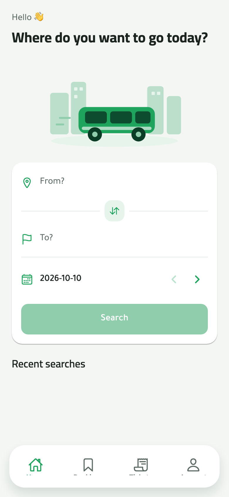
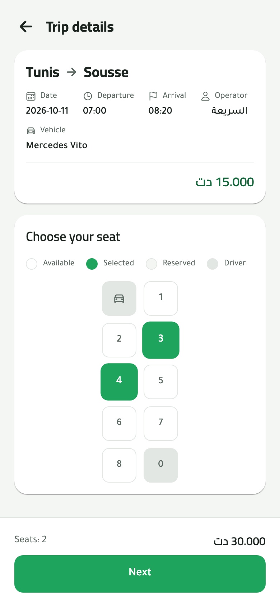
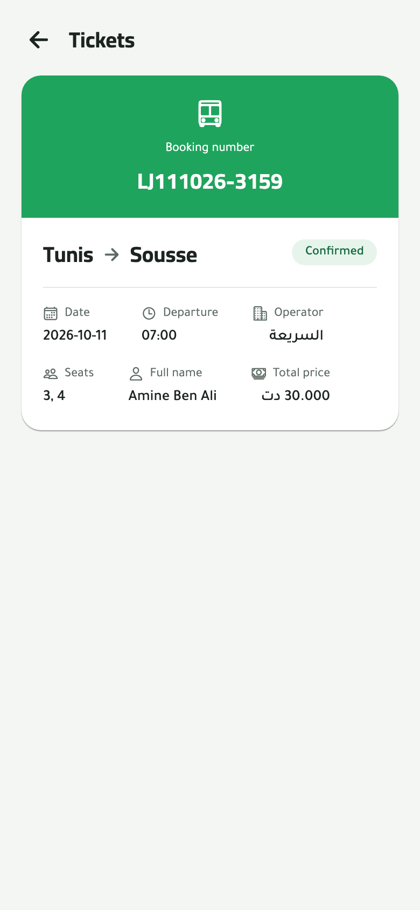
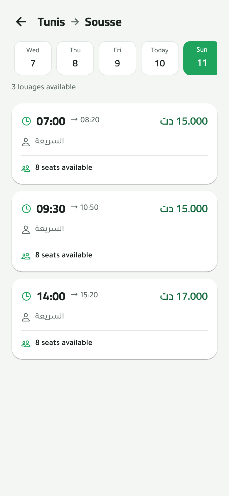
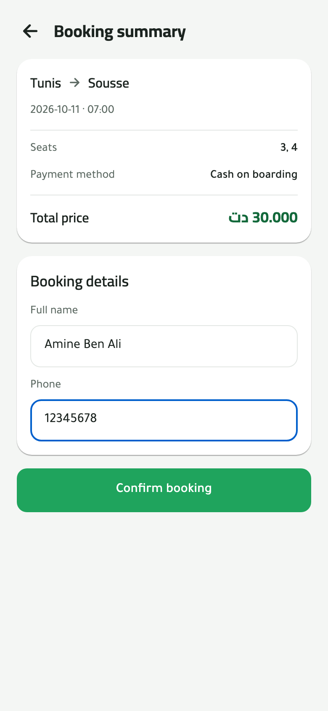
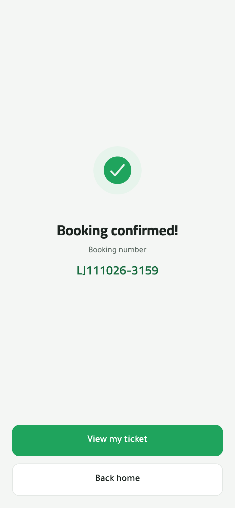
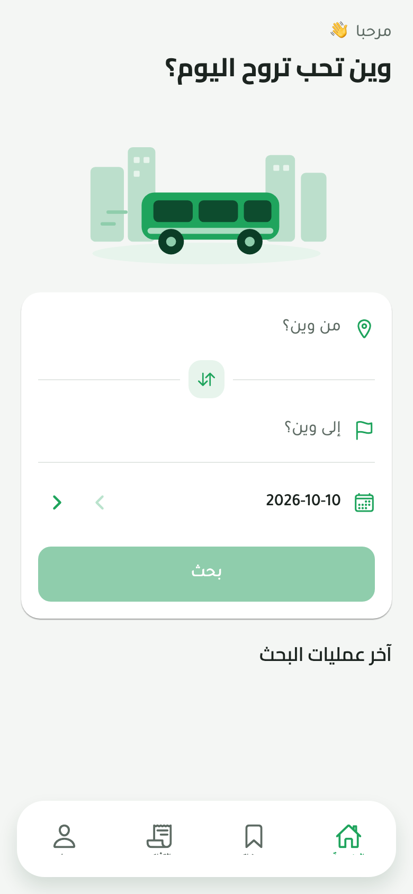
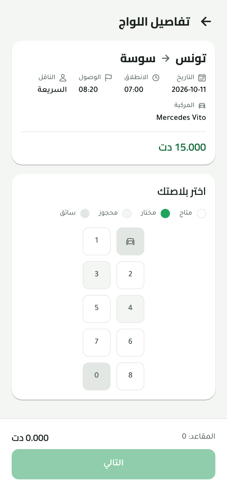
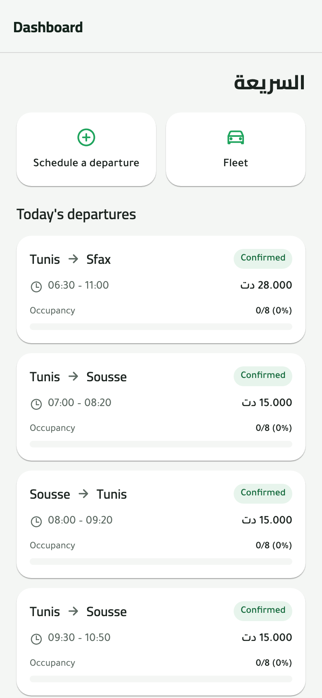

<div align="center">

# Louaji · لواجي

**وصلك في وقتو — _gets you there on time_**

Search intercity **louage** (Tunisian shared-van) departures and reserve your seat before you reach the station.

Mobile-first · Arabic-first (RTL) with French & English · Built with Expo + React Native for Web + Supabase





</div>

---

## Why Louaji

Louages leave when they're full. Today that means showing up at the station, hoping there's a seat, and waiting. Louaji lets passengers see which vans are leaving, when, and how many seats are left, then reserve a specific seat and pay cash when they board.

It has three sides:

| Side                     | Who                                       | What they do                                                                                           |
| ------------------------ | ----------------------------------------- | ------------------------------------------------------------------------------------------------------ |
| **Passenger app**        | Travelers                                 | Search a route and date, compare departures, pick seats on a seat map, book, and keep a digital ticket |
| **Operator back office** | Transport companies & independent drivers | Register a fleet, schedule departures, watch occupancy, manage bookings and boarding                   |
| **Super-admin**          | Platform team                             | Manage the city and route catalog, verify operators, oversee users                                     |

v1 ships as a **mobile web app** (phones first). Native iOS/Android builds come later from the same codebase.

## Screenshots

### Passenger flow

|                         Search                         |                          Results                          |                        Seat selection                        |
| :----------------------------------------------------: | :-------------------------------------------------------: | :----------------------------------------------------------: |
|  |  |  |

|                      Booking summary                      |                           Confirmed                            |                          Ticket                          |
| :-------------------------------------------------------: | :------------------------------------------------------------: | :------------------------------------------------------: |
|  |  |  |

### Arabic (RTL) · phone sign-in · operator

|                      العربية — Home                       |                      العربية — Seats                      |                    Phone OTP sign-in                    |                     Operator dashboard                     |
| :-------------------------------------------------------: | :-------------------------------------------------------: | :-----------------------------------------------------: | :--------------------------------------------------------: |
|  |  |  |  |

## Features

**Passenger**

- Phone-number sign-in with SMS one-time code
- Search by origin, destination and date, with a day strip to hop between dates
- Departure cards with times, operator, price (TND, stored as millimes) and live free seats
- Seat map with available / selected / reserved / driver states
- Short-lived **seat holds** so two people can't book the same seat
- Cash-on-boarding payment, booking number, digital ticket
- My bookings, tickets, notifications, account

**Operator**

- Onboarding as a company or an independent driver
- Fleet and vehicle management (seat count per louage)
- Departure scheduling per route, with price and arrival estimate
- Dashboard of today's departures with occupancy, plus a per-trip seat board

**Platform**

- City, route and operator catalog management
- Operator verification and user oversight
- Full Arabic RTL layout, with French and English

## Tech stack

| Layer               | Choice                                                                                                                                                   |
| ------------------- | -------------------------------------------------------------------------------------------------------------------------------------------------------- |
| App                 | [Expo SDK 55](https://expo.dev), React Native 0.83, React 19, [Expo Router](https://docs.expo.dev/router/introduction/) (file-based routes + API routes) |
| Web                 | React Native for Web, server output deployed on EAS Hosting                                                                                              |
| Styling             | [NativeWind v4](https://www.nativewind.dev/) (Tailwind CSS), Cairo / Tajawal type, green design tokens                                                   |
| Data                | [Supabase](https://supabase.com) (Postgres + PostGIS, Auth with phone OTP, Edge Functions, RLS)                                                          |
| Schema & migrations | [Drizzle ORM / drizzle-kit](https://orm.drizzle.team)                                                                                                    |
| Server state        | TanStack Query v5                                                                                                                                        |
| Validation          | Zod v4, `@t3-oss/env-core` for typed env                                                                                                                 |
| i18n                | i18next: `ar` (default, RTL), `fr`, `en`                                                                                                                 |
| Quality             | TypeScript strict, ESLint (flat config), Prettier, Husky + lint-staged                                                                                   |
| CI/CD               | GitHub Actions: PR checks, migration dry-run, staging & production deploys                                                                               |

## Architecture

Features follow a **hexagonal** layout so domain logic stays independent of Supabase and React:

```
src/
├── app/                      # Expo Router screens + API routes (+api.ts)
│   ├── (auth)/               # welcome, phone, verify
│   ├── (tabs)/               # home, bookings, tickets, account
│   ├── trip/[id]  booking/   ticket/[id]  results
│   ├── operator/             # dashboard, fleet, schedule, trip seat board
│   └── admin/                # cities, routes, operators, users
├── features/<feature>/
│   ├── core/                 # entities, ports, use-cases, errors (pure TS)
│   ├── adapters/supabase/    # port implementations
│   ├── api/                  # route handlers
│   ├── ui/                   # feature components
│   └── hooks/                # React Query hooks
├── db/schemas/               # Drizzle table definitions
└── shared/                   # config, i18n, design primitives, supabase/log/http libs
supabase/functions/           # Edge Functions: expire-holds, send-sms
drizzle/migrations/           # generated SQL + snapshots
```

Features: `auth`, `search`, `catalog`, `trips`, `booking`, `fleet`, `operators`, `notifications`, `account`, `admin`.

Seat booking is the fragile part. Seats are held for a short window, then confirmed or released, and the database enforces the rules so two passengers racing for the same seat can't both win. See [`docs/ARCHITECTURE.md`](docs/ARCHITECTURE.md) and [`docs/CAUTIONS.md`](docs/CAUTIONS.md).

## Getting started

### Prerequisites

- Node.js **≥ 22.13** (see [`.nvmrc`](.nvmrc))
- pnpm **≥ 10.7**
- Docker (running), for the local Supabase stack
- [Supabase CLI](https://supabase.com/docs/guides/cli) ≥ 2.67

### Run locally

```bash
pnpm install
cp .env.example .env          # then paste the keys printed by `pnpm db:status`
pnpm db:start                 # local Supabase (API :54421, DB :54422, Studio :54423)
pnpm db:migrate               # apply Drizzle migrations
pnpm db:seed                  # demo cities, routes, operator, 24 departures
pnpm web                      # http://localhost:8081
```

Open it in your browser's mobile view (or on your phone on the same network). The app is designed for phone screens.

### Demo accounts (local only)

The local stack uses Supabase's test-OTP mode, so the code is always **`123456`** and no SMS is sent.

| Role                          | Phone             |
| ----------------------------- | ----------------- |
| Passenger                     | `+216 12 345 678` |
| Operator (independent driver) | `+216 98 765 432` |

Seeded routes: Tunis ↔ Sousse, Tunis → Sfax. See [`SCENARIOS.md`](SCENARIOS.md) for end-to-end walkthroughs.

### Scripts

| Script                                    | What it does                                 |
| ----------------------------------------- | -------------------------------------------- |
| `pnpm dev`                                | Supabase + Expo dev server together          |
| `pnpm web`                                | Expo dev server, web target                  |
| `pnpm build:web`                          | Production web export                        |
| `pnpm typecheck`                          | `tsc --noEmit` (strict)                      |
| `pnpm lint` / `pnpm lint:fix`             | ESLint                                       |
| `pnpm format` / `pnpm format:check`       | Prettier                                     |
| `pnpm db:start` / `db:stop` / `db:status` | Local Supabase stack                         |
| `pnpm db:generate`                        | Generate a migration from schema changes     |
| `pnpm db:migrate`                         | Apply pending migrations                     |
| `pnpm db:seed`                            | Seed demo data (idempotent)                  |
| `pnpm db:reset`                           | ⚠️ Wipe the local DB, re-migrate and re-seed |

Docker alternative: `docker compose up --build` serves the web app on http://localhost:3100.

## Documentation

All product and engineering docs live in [`docs/`](docs/). Start with [`CLAUDE.md`](CLAUDE.md), the index.

| Doc                                  | Covers                                                                  |
| ------------------------------------ | ----------------------------------------------------------------------- |
| [SRS](docs/SRS.md)                   | What the product does: actors, flows, booking rules, MVP / future scope |
| [DESIGN](docs/DESIGN.md)             | Design tokens, typography, RTL, screen inventory                        |
| [ARCHITECTURE](docs/ARCHITECTURE.md) | Hexagonal layout, data model, seat-hold concurrency, RLS                |
| [TECHNOLOGIES](docs/TECHNOLOGIES.md) | Stack and the reasons behind it                                         |
| [ENVIRONMENTS](docs/ENVIRONMENTS.md) | Local / staging / production, branching, CI/CD                          |
| [CAUTIONS](docs/CAUTIONS.md)         | Pitfalls: concurrency, money in millimes, Tunis timezone, RTL, SMS      |
| [ROADMAP](docs/ROADMAP.md)           | Release scope and future work                                           |

## Roadmap

- [x] Passenger search → seat map → booking → ticket
- [x] Operator fleet, scheduling and dashboard
- [x] Super-admin catalog and operator verification
- [x] Arabic RTL, French, English
- [ ] Production SMS delivery for Tunisian numbers
- [ ] QR-code tickets and boarding scan
- [ ] Results filters, operator ratings, recurring schedules
- [ ] Native iOS and Android apps
